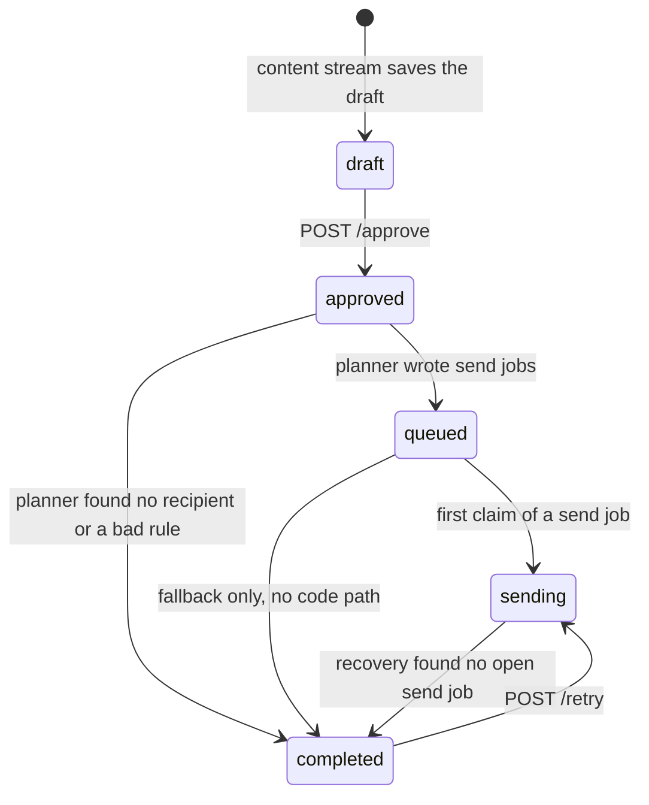
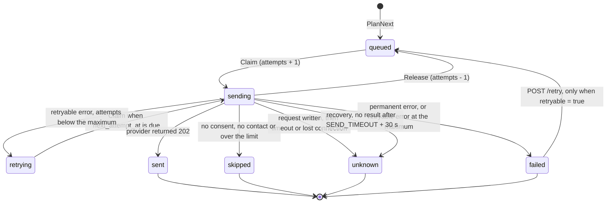
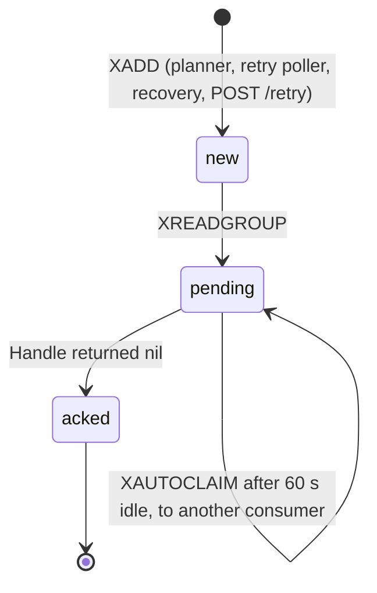
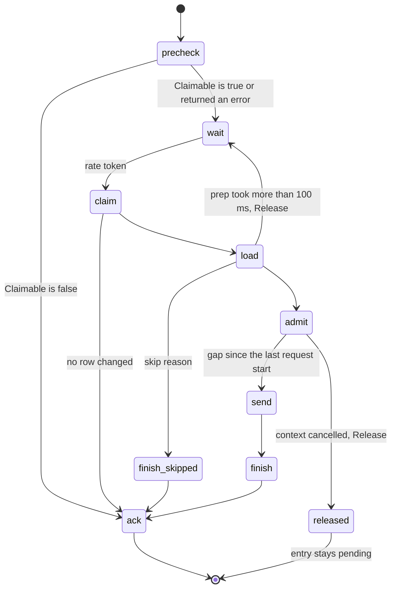
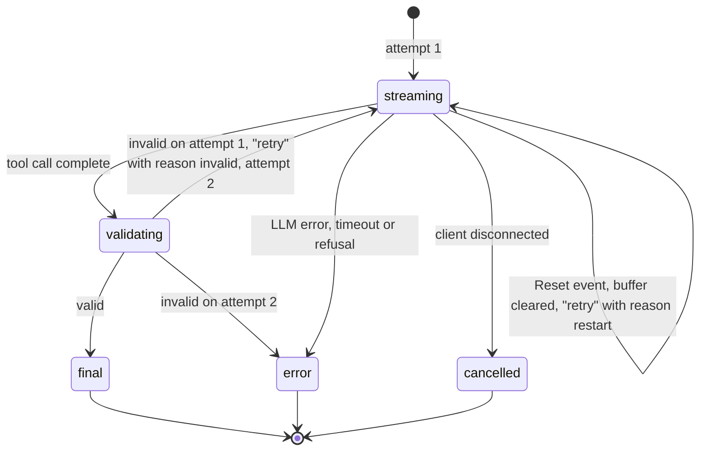
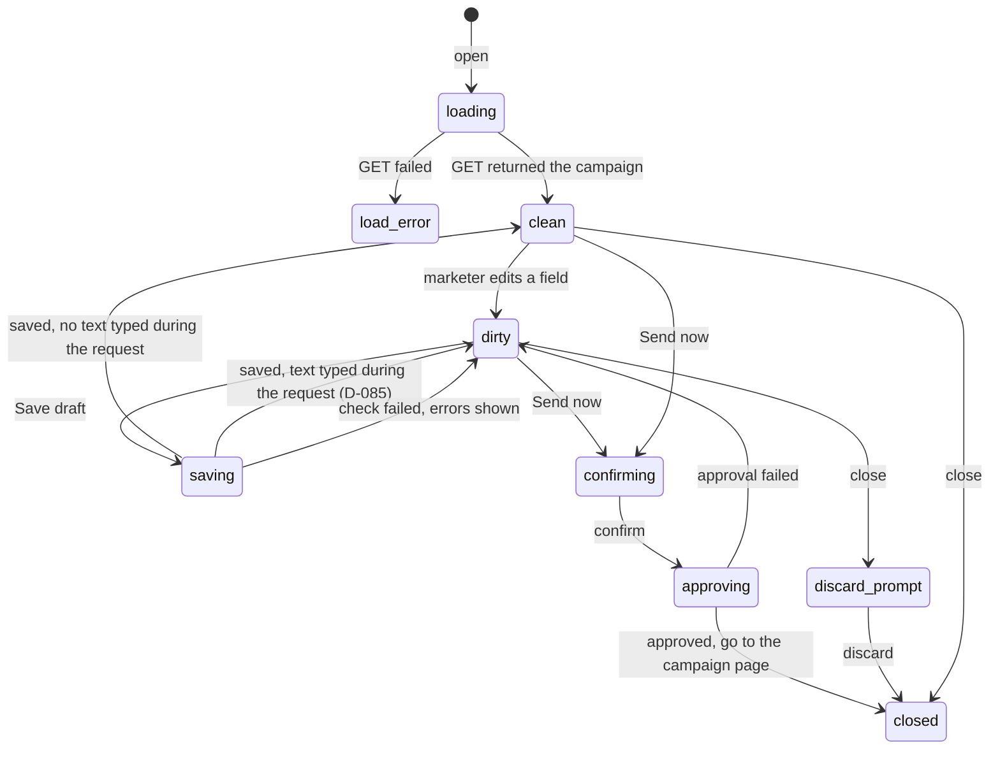
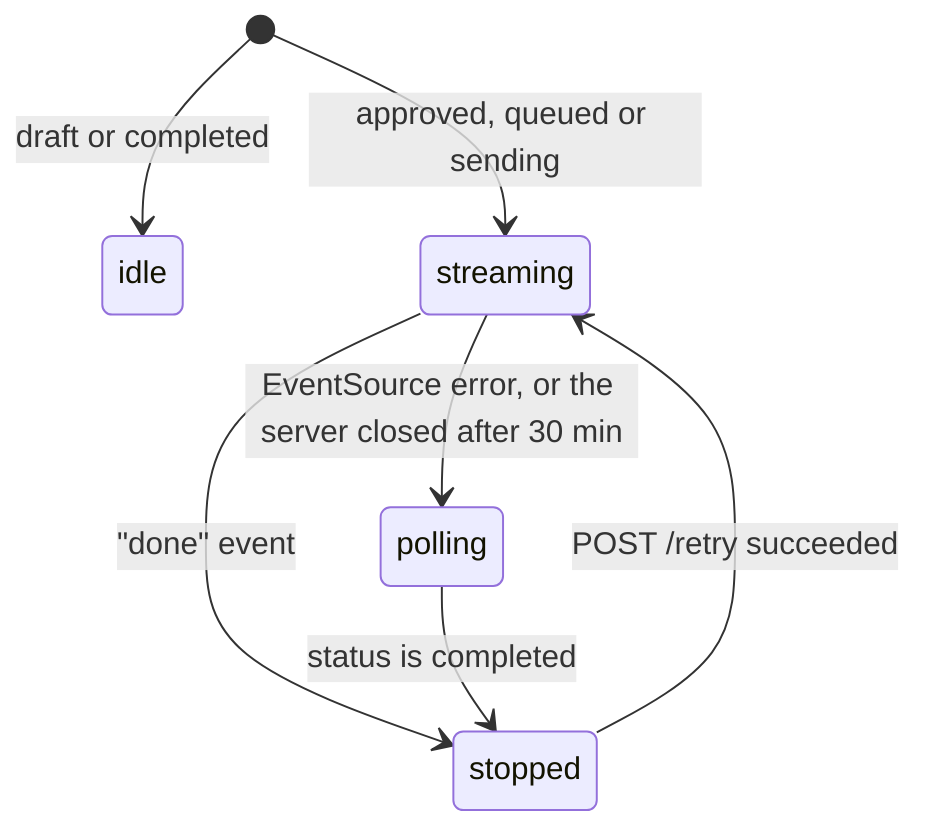

# State machines

This document lists the state machines in the code. Most of them have no explicit state type. Their states come from status columns, booleans, nullable fields and conditional `UPDATE` statements.

Each section gives:

- the place where the state lives
- the states
- the transitions, with the code that makes them
- the guard that blocks other transitions

The last section lists the gaps that we found and the changes that closed them.

## 1. Campaign status

**State:** `campaigns.status` in Postgres.

**Guard:** explicit. The trigger `campaigns_frozen_after_approval` in `00003_send_jobs.sql` allows only the transitions in the table. The writes are in three packages. They use the constants of `campaign.Status` (D-094).

| From | To | Code | Condition |
|---|---|---|---|
| (none) | `draft` | `campaign.Store.CreateDraft` | At least one language is final at the end of the content stream. |
| `draft` | `draft` | `ReplaceDraft`, `Update(approve=false)` | Content changes only. `ReplaceDraft` also needs the same brief and rule. |
| `draft` | `approved` | `campaign.Store.Update(approve=true)` | The content check passes. The row is locked. |
| `approved` | `approved` | `campaign.Store.Update(approve=true)` | A repeated approval. It returns `repeat = true` and changes nothing. |
| `approved` | `queued` | `delivery.Store.PlanNext` | The planner inserted one or more send jobs. |
| `approved` | `completed` | `delivery.Store.PlanNext` | The planner inserted no send job, or the stored rule is not valid. |
| `queued` | `sending` | `delivery.Store.Claim` | The same transaction claims the first send job. |
| `queued`, `sending` | `completed` | `delivery.Store.CompleteCampaigns` | No send job is `queued`, `sending` or `retrying`. Recovery runs it every 5 s. |
| `completed` | `sending` | `delivery.Store.Retry` | One or more `failed` send jobs have `retryable = true`. |

Other rules:

- `approved_at` is null only in `draft`. A `CHECK` constraint enforces this.
- After `draft`, the brief, the rule, the description, the skipped languages and `approved_at` cannot change. The trigger enforces this.
- The trigger `campaign_contents_draft_only` blocks all writes to `campaign_contents` after `draft`.
- `UpdateCounts` does nothing when the status is not `draft`.

## 2. Send job status

**State:** `send_jobs.status`, `attempts`, `next_attempt_at`, `retryable` and `enqueued_at` in Postgres.

**Guard:** explicit since D-091. Each `UPDATE` has a `WHERE status = ...` condition. The trigger `send_jobs_status_moves` in `00005_send_job_transitions.sql` is the second guard. It allows only the moves in the diagram. The comment in `types.go` names the terminal states: `sent`, `failed`, `unknown` and `skipped`.

| From | To | Code | Condition |
|---|---|---|---|
| (none) | `queued` | `PlanNext` | One row for each reachable user and channel. The unique key `(campaign_id, user_id, channel)` blocks a second row. |
| `queued` | `sending` | `Claim` | Always. `attempts` goes up by 1. |
| `retrying` | `sending` | `Claim` | `next_attempt_at <= now`. `attempts` goes up by 1. |
| `sending` | `queued` | `Release` | Nothing was sent. The causes are a cancelled context, a `Load` error, a rate token older than 100 ms, a cancelled `Admit`, or a failed write of a skip result (D-092). `attempts` goes down by 1. |
| `sending` | `skipped` | `Consumer.Handle` and `Finish` | `Load` returned `no_consent`, `no_contact` or `over_limit`. |
| `sending` | result of `Next` | `Consumer.Handle` and `Finish` | See the table below. |
| `sending` | `unknown` | `ExpireSending` | `updated_at` is older than `SEND_TIMEOUT` plus 30 s. |
| `failed` | `queued` | `Retry` | The campaign is `completed` and `retryable = true`. `attempts`, `next_attempt_at` and `enqueued_at` are reset. |

`policy.go` `Next` maps the provider outcome to the new status:

| Outcome (`provider.go`) | Cause | New status | `retryable` |
|---|---|---|---|
| `Delivered` | `202` | `sent` | `false` |
| `Retryable` | `429`, `5xx`, or a connection error before the request was written | `retrying`, with backoff or `Retry-After` | `false` |
| `Retryable` at `attempts >= MaxAttempts` | as above | `failed` | `true` |
| `Ambiguous` | timeout, cancel or lost connection after the request was written | `unknown` | `false` |
| `Permanent` | other `4xx`, or a request that could not be built | `failed` | `false` |

Sub-state of `queued`: `enqueued_at`.

- `enqueued_at` is null after `PlanNext` and after `Retry`. The job is not on the stream yet.
- `MarkEnqueued` sets it after a successful `XADD`.
- `StaleQueued` returns the jobs with a null or old `enqueued_at`. Recovery pushes them again if the stream has no lag.

## 3. Queue entry

**State:** a Redis stream entry in `send:sms` or `send:email`, and its place in the group `workers`.

**Guard:** Redis. The send job status in Postgres decides what the entry does.

- `Handle` acknowledges the entry when `Claimable` or `Claim` finds no job to take. Thus a duplicate entry, or an entry for a job in a terminal state, uses no rate token.
- `Handle` keeps the entry pending when an error occurs. Examples are a cancelled wait, a `Claim` error, a `Load` error, and a `Finish` error.
- After a `Finish` error, the job stays in `sending`. A new claim fails. Thus the entry is acknowledged at the next delivery, and `ExpireSending` later sets the job to `unknown`.
- A skip result is the exception. After a failed write, the consumer releases the job to `queued`. The next delivery skips it again (D-092).

## 4. Consumer step for one entry

**State:** local variables in `Consumer.Handle`.

D-086 gives the order: wait, claim, load, send. The job stays `queued` during the wait. Thus recovery cannot expire a job that waits for a token. D-090 adds `Admit` between the load and the send. It keeps the request starts of one channel apart.

## 5. Channel rate limiter

**State:** `Limiter.pausedUntil` and the token bucket in `limiter.go`. Each channel has one limiter in each worker process.

- **open:** `Wait` takes a token. The bucket allows `SEND_RATE_PER_SEC` with a burst of 1.
- **paused:** `now < pausedUntil`. `Wait` sleeps until the pause ends.
- `Pause(Retry-After)` moves the limiter to paused after a `429`. A shorter pause does not shorten a longer one.
- `Wait` checks the pause again after it gets a token. Thus a pause that starts during the sleep also applies.
- `Admit` is a second gate before each request. It keeps the request starts at least `1s/perSec` plus 2% apart (D-090).

## 6. Retry push memory

**State:** `Worker.pushedRetries`, a map in memory from a job id to the time of its last push.

- **not pushed:** the job is due and not in the map. `pollRetries` pushes it and adds it to the map.
- **pushed:** the job is in the map and the push is less than 30 s old. The poller does not push it again.
- **late:** the push is 30 s old or older. The poller or recovery pushes it again.
- `pollRetries` removes the jobs that are no longer due. A later retry of the same job is a new one.

The map is local to one worker process. Two workers can push the same job. The claim makes this safe.

## 7. Content generation for one language

**State:** the loop in `httpapi/content.go` `runLanguage`, and `drafter.buf`.

The request around the languages:

1. The api validates the brief and the rule, and counts the audience. A failure gives a JSON error, not a stream.
2. The stream sends `audience`.
3. All languages run at the same time. A failure in one language does not stop the others.
4. If the client disconnected, the api saves nothing.
5. If one or more languages are final, the api creates or replaces the draft and sends `campaign`. Else it saves nothing.
6. The stream sends `done`.

The frontend card in `content-cards.vue` follows the same events:

| Card state | Fields | Event that sets it |
|---|---|---|
| waiting | no `draft`, no `final`, no `retry` | `audience` |
| drafting | `draft` set, `retry` cleared | `draft` |
| restarting | `draft` cleared, `retry = 'restart'`, "Starting again…" | `retry` with `reason: "restart"` |
| repairing | `draft` cleared, `retry = 'invalid'`, "Fixing content…" | `retry` with `reason: "invalid"`, or with no reason |
| final | `final` set | `final` |
| error | `error` set | `error` with a language |
| closed | `closed = true` | the stream closed early before `final` or `error` |

The run around the cards has its own state:

- `running` is true from the request until the end of the stream.
- `campaignId` is the draft of the current run. The review button needs it.
- `draftId` is the draft that "Regenerate content" replaces. A new "Find audience" sets it to null. The error `campaign_conflict` also sets it to null.
- `token` drops the events of an older run.

## 8. Segment preview

**State:** the `attempts` loop in `httpapi/segments.go`.

1. Attempt 1 sends the brief.
2. If the answer is not valid, attempt 2 sends the errors as a `tool_result` with `is_error: true`.
3. If attempt 2 is also not valid, the api returns `422`.
4. An LLM error or a refusal ends the loop at once.
5. A valid rule goes to the audience count. A count error gives `503`.

## 9. Review window

**State:** refs in `review-dialog.vue`: `campaign`, `loadError`, `busy`, `confirmOpen`, `discardOpen`, `open`, and the computed values `dirty` and `isDraft`.

- `busy` is true in saving and approving. A close does nothing while `busy` is true.
- `loadToken` drops the responses of an older load.
- An open loads the campaign again, except when the edits of the same campaign are not saved.
- A failed content check calls `refreshLimits`. This loads the new counts and keeps the edits.

## 10. Campaign page progress

**State:** `watchProgress` in `lib/delivery.ts`, and `progress` in `pages/campaigns/[id].vue`.

- The page does not go back from polling to streaming. It polls every 2 s until the status is `completed`.
- `currentStep` maps the campaign status to the step of the sending window. It takes a `SendableStatus`, which has no `draft`. It has one case for each status and no `default` case (D-094).

## Gaps

We found these gaps on 2026-11-11. The list gives the change that closed each one.

1. **The send job status had no guard in the database.** Fixed by D-091. The trigger `send_jobs_status_moves` allows only the moves of section 2. The test fixtures use `setJobs`, which moves each job through `sending`.
2. **`queued → completed` has no code path.** Kept by D-091. `Claim` moves the campaign to `sending` in the same transaction as the first claim. The trigger still allows the move as a fallback for `CompleteCampaigns`. Without it, a campaign could stay in `queued` for ever. A comment in `00005_send_job_transitions.sql` records this.
3. **A `Finish` error gave `unknown`, also when nothing was sent.** Fixed by D-092 for skips. Other results keep the old behaviour, because a release would lose the backoff or could send a message two times.
4. **The `retry` event had two meanings.** Fixed by D-093. The event has `reason`, and the card shows a different text for each reason.
5. **`currentStep` mapped `draft` to `approved`.** Fixed by D-094. The type of the parameter has no `draft`, and the switch has no `default` case.
6. **Two state names have the same text.** Reduced by D-094. Go code uses `campaign.Status` constants for the campaign and `delivery.Status` for the send job. The frontend has `CampaignStatus`, `SendableStatus` and `DeliveryStatus`. The values in the database and the API do not change.
